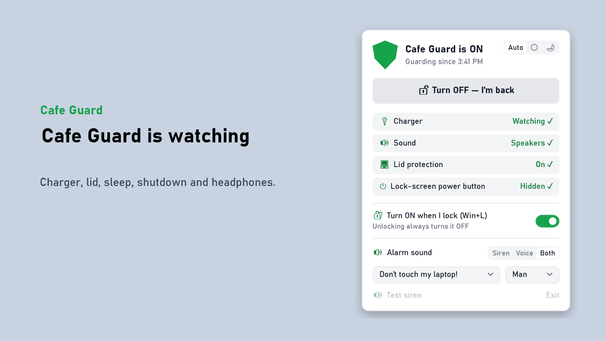

# 🛡️ Cafe Guard

**A loud alarm that protects your laptop while you step away at the café.**

Alone at a coffee shop and need the bathroom? Click the shield near the clock and turn Cafe Guard **ON**.
If anyone unplugs the charger, closes the lid, tries to shut the laptop down, or opens Task Manager,
a siren (and, if you like, a voice) plays at **full volume** — and the mute and volume keys don't stop it.
When you come back, click **Turn OFF**: Windows asks for your PIN or fingerprint, so only you can stop it.



- **Free**, no account, no internet, no data collected
- Windows 10 (2004 or later) and Windows 11, on laptops
- Microsoft Store: **in review** — [Store page](https://apps.microsoft.com/detail/9N8FHQ4X67LN) (works once approved)

---

## How to use it

1. **Plug in your charger.** Cafe Guard watches it, so it needs to be plugged in to turn ON.
2. **Click the shield** near the clock (if you don't see it, click **^** and drag it onto the taskbar).
3. Click **🔒 Turn ON — going to bathroom.** The shield turns solid green.
4. When you're back, click **🔓 Turn OFF — I'm back** and confirm with your Windows PIN or fingerprint.

The shield tells you the state at a glance — two colors only:

| Shield | Meaning |
|---|---|
| Green outline | OFF |
| Solid green | ON — guarding |
| Blinking red | ALARM |

### What sets off the alarm (while ON)

| Someone… | Cafe Guard… |
|---|---|
| unplugs the charger | sounds the alarm |
| closes the lid | sounds the alarm (the laptop does **not** go to sleep) |
| tries to sleep or shut down | sounds the alarm and blocks it |
| plugs headphones into the laptop's jack | sounds the alarm and keeps the sound on the speakers |
| opens Task Manager | sounds the alarm (a normal "End task" is also refused) |

During an alarm the red card pops up on top of everything and stays there until you turn Cafe Guard OFF with your PIN.
Bluetooth or USB earbuds that connect by themselves don't cause an alarm — the sound is simply moved back to the speakers.

### Options on the card

| Option | What it does |
|---|---|
| **🔊 Alarm sound** | **Siren**, **Voice** or **Both**. Pick the words — "Don't touch my laptop!", "Please put the laptop down.", and more — and a man's or woman's voice. |
| **🔐 Turn ON when I lock (Win+L)** | Locking Windows turns the guard ON by itself; unlocking turns it OFF. |
| **⏻ Lock-screen power button — Hide / Show** | Hides the power button on the lock screen, so nobody can shut down a locked laptop without your password. Windows asks for permission. Click **Show** to put it back — do this **before uninstalling**, because Windows doesn't let Store apps undo changes when they are uninstalled. |
| **Auto · ☀ · 🌙** | Light or dark look (Auto follows Windows). |
| **🔊 Test siren** | Plays your alarm sound for 7 seconds (turn your volume down first!). |

### Honest limits

No app can beat these, so it's good to know them:

- Holding the power button for about 5 seconds forces any laptop off.
- On an **administrator** account, Task Manager runs with full rights and can still close Cafe Guard — but only after the alarm has gone off. For the strongest protection, press **Win+L** before you leave: nobody can reach Task Manager on the lock screen.
- If Cafe Guard isn't running, nothing is guarded. It starts with Windows by itself (you can turn that off in **Settings → Apps → Startup**).

---

## Privacy

Cafe Guard does not collect, store or send any personal information and never connects to the internet.
Your settings and a small activity log stay on your computer. When you turn it OFF, **Windows** checks your PIN or
fingerprint — Cafe Guard never sees them, only a yes or no. The spoken warning is made on your computer by Windows'
built-in voices.

---

## Build it yourself

You need Windows 10/11, the [.NET 8 SDK](https://dotnet.microsoft.com/download/dotnet/8.0) and the
[Windows SDK](https://developer.microsoft.com/windows/downloads/windows-sdk/) (for `makeappx.exe`).

```bat
windows\run-tests.bat          :: run the automatic tests
Build-Store.bat                :: build dist\store\CafeGuard_<version>_x64.msix
Store-Test.bat install         :: install that package on this PC (needs Developer Mode)
Store-Test.bat remove          :: uninstall it again
```

To publish your own build in the Microsoft Store, put your Partner Center identity in
`windows/CafeGuard.Store/store-identity.json` — see [docs/store/partner-center-guide.md](docs/store/partner-center-guide.md).

Log file: `%LOCALAPPDATA%\CafeGuard\cafeguard.log` · Settings: `%LOCALAPPDATA%\CafeGuard\settings.json`

### Project layout

| Folder | What's in it |
|---|---|
| `windows/CafeGuard/` | The tray app (.NET 8, WinForms + WPF): guard logic, alarm sound, the pop-up card |
| `windows/CafeGuard.Shared/` | Look and feel (green palette, styles, shield), settings, paths, registry helpers |
| `windows/CafeGuard.Store/` | Microsoft Store package description, logos and identity |
| `windows/CafeGuard.Tests/` | Automatic tests (xUnit) |
| `tools/` | Build scripts and the scripts that draw the icons and Store screenshots |
| `docs/` | Store submission guide, screenshots, design notes |
| `macos/` | An early, separate Mac version (Python) — not tested on a real Mac yet |
| `archive/` | Old versions, kept for reference |

---

## License

[MIT](LICENSE) © 2026 Taing Sunnguon
