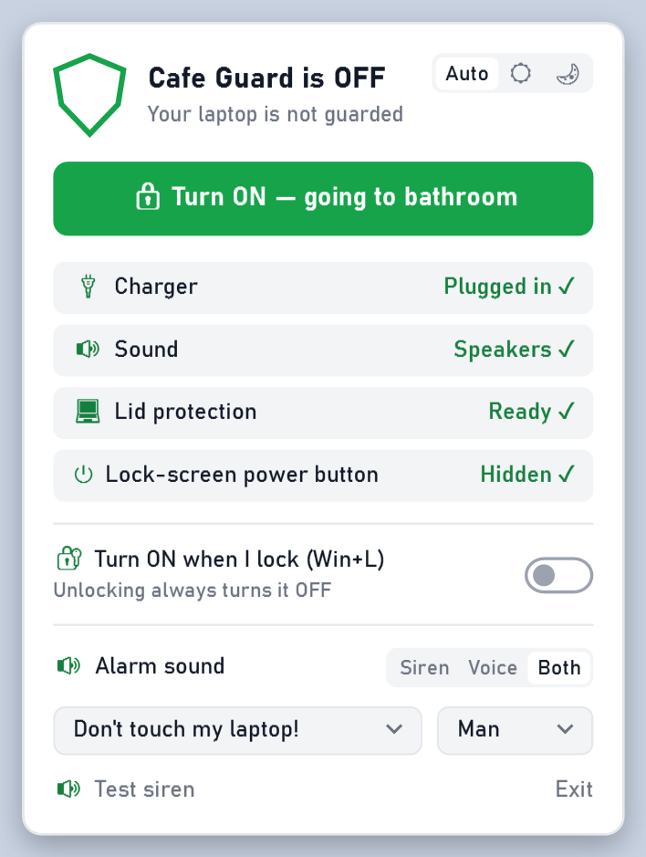
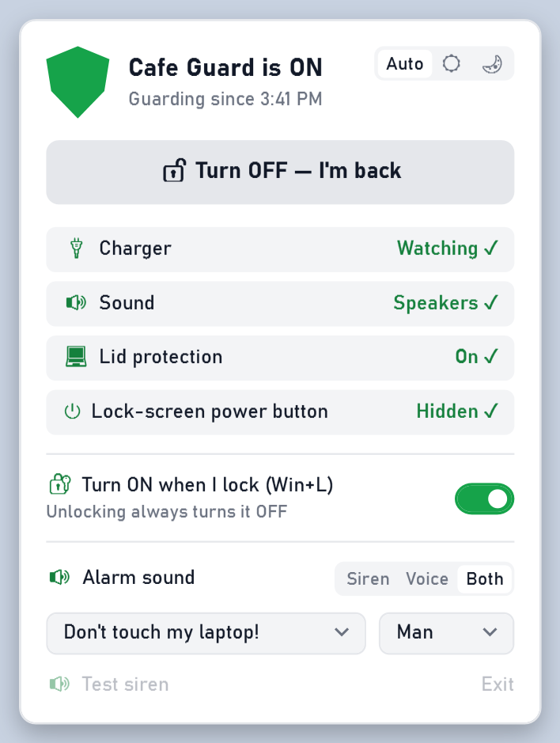
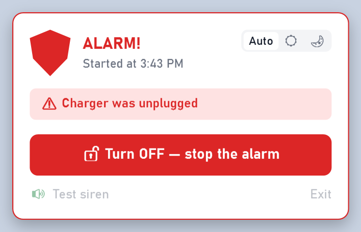

<p align="center">
  
</p>

<h1 align="center">Cafe Guard</h1>

<p align="center">
  <b>A loud alarm that protects your laptop while you step away at the café.</b>
</p>

<p align="center">
  <a href="https://apps.microsoft.com/detail/9N8FHQ4X67LN?referrer=appbadge&mode=direct">
    
  </a>
</p>

<p align="center">
  
  
  
  <a href="LICENSE"></a>
</p>

<p align="center">
  
</p>

---

## Overview

Working alone at a coffee shop and need a break? Turn Cafe Guard **ON** from the shield next to the clock and walk away.
If anyone unplugs the charger, closes the lid, tries to shut the laptop down or opens Task Manager, Cafe Guard sounds a
siren and a spoken warning at **full volume** — and the mute and volume keys can't stop it. When you return, turn it
**OFF** with your Windows PIN or fingerprint. Nobody else can.

> **Microsoft Store:** Cafe Guard is currently in certification. The badge above opens its Store page once it is published.

## Features

- **One click** to turn ON and OFF from the system tray
- **Siren, voice, or both** — choose the words and a man's or woman's voice
- **Owner-only shutdown** — turning OFF requires Windows Hello (PIN, fingerprint or face)
- **Tamper detection** — charger, lid, sleep, shutdown, headphone jack and Task Manager
- **Lock-screen protection** — optionally hide the lock-screen power button; optionally turn ON automatically with **Win+L**
- **Light and dark** themes that follow Windows
- **Private by design** — no account, no internet connection, no data collected

## Screenshots

<table>
  <tr>
    <td align="center" width="33%"><br><sub><b>OFF</b> — ready, all checks green</sub></td>
    <td align="center" width="33%"><br><sub><b>ON</b> — guarding your laptop</sub></td>
    <td align="center" width="33%"><br><sub><b>ALARM</b> — siren and voice at full volume</sub></td>
  </tr>
</table>

## How it works

| While ON, if someone… | Cafe Guard… |
|---|---|
| unplugs the charger | sounds the alarm |
| closes the lid | sounds the alarm — the laptop stays awake |
| tries to sleep or shut down | sounds the alarm and blocks it |
| plugs headphones into the laptop's jack | sounds the alarm and keeps the sound on the speakers |
| opens Task Manager | sounds the alarm; a normal **End task** is refused |

During an alarm, a red card stays on top of the screen until the owner turns Cafe Guard **OFF**.
Bluetooth or USB earbuds that connect by themselves never cause an alarm — the sound simply moves back to the speakers.

| Shield | State |
|---|---|
| Green outline | OFF |
| Solid green | ON — guarding |
| Blinking red | ALARM |

## Getting started

1. Install Cafe Guard from the **[Microsoft Store](https://apps.microsoft.com/detail/9N8FHQ4X67LN)**. It starts with Windows automatically.
2. Plug in your charger and click the **shield** next to the clock (click **^** first if it's hidden).
3. Click **Turn ON — going to bathroom**.
4. When you're back, click **Turn OFF — I'm back** and confirm with your PIN or fingerprint.

> **Before uninstalling:** if you hid the lock-screen power button, click **Show** on the card first.
> Windows doesn't let Store apps undo system changes when they are removed.

## Limitations

- Holding the power button for about five seconds forces any laptop off.
- On an administrator account, Task Manager can still close Cafe Guard — but only after the alarm has gone off.
  For the strongest protection, also press **Win+L** before you leave.
- Cafe Guard only guards while it is running.

## Privacy

Cafe Guard does not collect, store or transmit personal information and never connects to the internet.
Settings and a small activity log stay on your computer. Windows verifies your PIN or fingerprint — Cafe Guard never
sees them. The spoken warning is generated locally by Windows' built-in voices.

## Building from source

**Requirements:** Windows 10/11, [.NET 8 SDK](https://dotnet.microsoft.com/download/dotnet/8.0),
[Windows SDK](https://developer.microsoft.com/windows/downloads/windows-sdk/).

```bat
windows\run-tests.bat        :: run the test suite
Build-Store.bat              :: build dist\store\CafeGuard_<version>_x64.msix
Store-Test.bat install       :: install the package locally (requires Developer Mode)
Store-Test.bat remove        :: uninstall it
```

To publish your own build, set your Partner Center identity in `windows/CafeGuard.Store/store-identity.json`.
See the [Store submission guide](docs/store/partner-center-guide.md).

<details>
<summary><b>Project structure</b></summary>

| Path | Contents |
|---|---|
| `windows/CafeGuard/` | Tray app (.NET 8, WinForms + WPF): guard logic, alarm sound, pop-up card |
| `windows/CafeGuard.Shared/` | Theme, styles, settings, paths and registry helpers |
| `windows/CafeGuard.Store/` | MSIX manifest template, logos and Store identity |
| `windows/CafeGuard.Tests/` | xUnit test suite |
| `tools/` | Build scripts; icon, logo and screenshot generators |
| `docs/` | Store guide, screenshots, design notes |
| `macos/` | Early experimental Mac version (Python, untested) |
| `archive/` | Earlier versions, for reference |

Logs: `%LOCALAPPDATA%\CafeGuard\cafeguard.log` · Settings: `%LOCALAPPDATA%\CafeGuard\settings.json`

</details>

## License

Released under the [MIT License](LICENSE). © 2026 Taing Sunnguon
